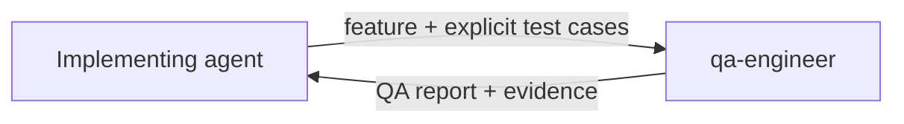

# QA engineer subagent — definition and requirements

This document describes the **qa-engineer** custom agent ([`.cursor/agents/qa-engineer.md`](../.cursor/agents/qa-engineer.md)): what it is, what it must do, and how the implementing agent must invoke it. It complements [`.cursor/rules/forma_de_trabajo.mdc`](../.cursor/rules/forma_de_trabajo.mdc).

## What “subagent” means here

In Cursor, **qa-engineer** is a **custom agent** (separate prompt + model profile), not a Skill. Skills under `.cursor/skills/` teach *how* to do something (e.g. browser automation). The QA agent owns *when* to run checks and *what* to deliver: a single verification report.

## Definition

**QA engineer subagent:** A dedicated verification role that runs the project’s automated checks (Vitest at the repository root and, when relevant, workspace-scoped tests), executes **browser integration checks** using `agent-browser` per [`.cursor/skills/executing-browser/SKILL.md`](../.cursor/skills/executing-browser/SKILL.md), and produces **one structured markdown report** with pass/fail, evidence (screenshots for UI flows), and actionable failure detail. It **does not** implement fixes unless scope is explicitly expanded. It prioritizes **caller-supplied acceptance scenarios**; full regression is out of scope unless requested.

## Requirements checklist

### Role and boundaries

- [ ] **Verify, don’t fix:** Report failures with reasons and optional suggestions; no implementation work by default.
- [ ] **Two-layer verification:** (1) `npm run test` at root, plus `npm run test -w app|api|packages/shared` when the change is localized; (2) browser flows for UI/behavioral acceptance.
- [ ] **Evidence:** Screenshots under `qa-evidence/` at the repo root, stable filenames, paths cited in the report.
- [ ] **React 19+ controlled inputs:** Use native events via `agent-browser eval` when `fill`/`click` are unreliable (see the agent file).

### Inputs (from the parent agent)

- [ ] **Preferred:** Explicit numbered test cases / acceptance criteria (required by project rules).
- [ ] **Optional:** Feature name, files touched, URL or route.
- [ ] **Fallback:** If no cases are given, minimal sanity (app loads + feature-related flow + relevant side-effects).

### Outputs

- [ ] **Report schema:** As defined in [`.cursor/agents/qa-engineer.md`](../.cursor/agents/qa-engineer.md) — Unit Tests table, Integration Tests table, Overall Result, **QA Verdict** (`ALL CLEAR` / `ISSUES FOUND`), optional Failures Detail.
- [ ] **Precision:** Exact errors or observed behavior, not vague summaries.

### Operational

- [ ] Run commands from the **repository root** (portable across machines).
- [ ] `npm run dev` if the app is not running before browser tests; default URL `http://localhost:5173` unless the project overrides it.
- [ ] `agent-browser` on PATH; follow `executing-browser` skill from the workspace copy (relative path, not another machine’s absolute path).

### Non-functional

- [ ] **Efficiency:** Do not run unrelated full regression when the caller scoped specific cases.

## Contract with the implementing agent

The implementing agent must: (1) finish the change; (2) pass **specific** test cases to qa-engineer; (3) **wait** for the structured report before closing the task.

## Stack reference

React (Vite), Tailwind, Supabase, npm workspaces: `app`, `api`, `packages/shared` — see root [README.md](../README.md).
